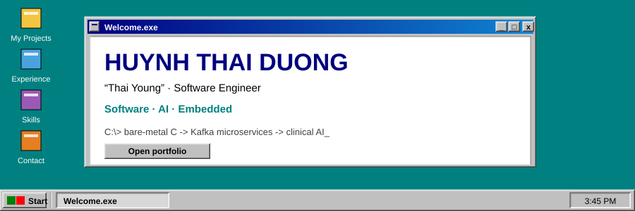

<!-- markdownlint-disable MD033 MD041 -->
<div align="center">

<a href="https://tduong04.github.io">
  
</a>

<a href="https://git.io/typing-svg">
  
</a>

<br/>


[](https://tduong04.github.io)
[](https://www.linkedin.com/in/hu%E1%BB%B3nh-th%C3%A1i-d%C6%B0%C6%A1ng-4aa58824a/)
[](mailto:thaiduong.works@gmail.com)
[](https://github.com/TDuong04)


</div>

<div></div>

**Software Engineer** and **Software Engineering (Honours)** graduate from **RMIT University**, working across backend platforms, AI applications and systems software.

- 💻 **Focus:** Building software across backend platforms, AI applications and systems
- 🧬 **Capstone:** [*Vital Agent*](https://github.com/Oucru-Innovations/vital-agent), an ECG/PPG recording-quality platform built with the **Oxford University Clinical Research Unit (OUCRU)** and deployed on their infrastructure
- 🌱 **Learning:** agentic development workflows and applied AI
- 💬 **Coding since grade 12** (C++), now four years in
- 🇻🇳 Vietnamese (native) · 🇬🇧 English (fluent)

> **⚠ Message from Duong:** Always happy to talk embedded, backend, or AI. [Email me](mailto:thaiduong.works@gmail.com) &nbsp; `[ OK ]`

<div></div>

| | Achievement |
|---|---|
| 🥉 | **Bosch CodeRace**: 2nd Runner-Up, real-time CAN-bus hill-driving safety system |
| 🥉 | **NAVER AI Hackathon**: 2nd Runner-Up (top 10% of projects), *Travista* |
| 🏁 | **Vin Hackathon 2026**: Finalist, "Green Application" backend |
| 🧪 | **Katalon Testathon**: Top 5, found 40/40 defects, automated 26 test cases |

<div></div>

<table>
<tr>
<td width="170"><b>Apr – Sep 2026</b></td>
<td>
<b>Capstone Collaborator / Full-Stack Developer</b>, <a href="https://www.oucru.org/">OUCRU</a> (Team Code4Care)<br/>
Built the backend for <a href="https://github.com/Oucru-Innovations/vital-agent"><i>Vital Agent</i></a>, an ECG/PPG research-recording quality platform: <b>11 FastAPI REST modules</b> covering auth, RBAC, audit, review and study-scoped data access. Implemented the Qwen-based assistant that explains deterministic signal-quality results and invokes guarded backend actions, with study-scoped authorization, versioned reviews/reports and auditable human-review history. Co-developed hallucination and noisy-data safeguards: on a 115-case safety set, dangerous unsupported answers fell <b>32.1% → 0%</b> and safety accuracy rose <b>81.7% → 97.4%</b>. Deployed on OUCRU infrastructure for internal use (~50 patients/day).
</td>
</tr>
<tr>
<td><b>Mar – Sep 2026</b></td>
<td>
<b>Software Engineering Intern</b>, <a href="https://www.navercorp.com/">NAVER Vietnam</a><br/>
Built the Java/Spring Boot backend for the internal <i>Interview Pool</i> recruitment platform. Integrated NAVER's AI service (Model Connect) for automated CV analysis and interview summaries. Worked with agent-based dev pipelines for ticketing, issue resolution and PR review.
</td>
</tr>
<tr>
<td><b>Jun 2025 – Feb 2026</b></td>
<td>
<b>Technology Manager</b>, RMIT Neo Culture Tech Club<br/>
Led a 40-member tech department across 9 concurrent projects.
</td>
</tr>
</table>

<div></div>

<details open>
<summary><b>Languages & backend</b></summary>
<br/>


`Java` · `Python` · `C` · `C++` · `AArch64 Assembly` · `TypeScript` · `SQL` · `Spring Boot` · `Spring Cloud Gateway` · `Spring Security` · `FastAPI` · `Kafka` · `JWT/OAuth2` · `RBAC & audit design`
</details>

<details open>
<summary><b>AI & machine learning</b></summary>
<br/>


`Qwen LLM assistants` · `guarded agent actions` · `LLM safety evaluation` · `YOLOv8` · `TensorRT/CUDA` · `HyperCLOVA X` · `LLM orchestration` · `Signal processing / HRV`
</details>

<details open>
<summary><b>Embedded & systems</b></summary>
<br/>


`C++ MCU base software` · `Automotive ADAS` · `Bare-metal` · `Boot flow & drivers` · `UART / SPI / GPIO` · `CAN bus (MCP2515)` · `MQTT` · `Jetson Nano` · `Nuvoton NUC140` · `Interrupt-driven FSMs`
</details>

<details>
<summary><b>Frontend, cloud & tooling</b></summary>
<br/>


`Docker` · `AWS (EC2, S3)` · `GCP` · `GitHub Actions CI/CD` · `Katalon` · `HIL testing` · `Jira / Agile`
</details>

<div></div>

### 📁 C:\Projects\Software_and_AI

<table>
<tr>
<td colspan="2" valign="top">

#### 🫀 [Vital Agent](https://github.com/Oucru-Innovations/vital-agent) · with OUCRU (Oxford)
*Apr – Sep 2026 · Capstone, deployed*

ECG/PPG research-recording quality platform. Backend of **11 FastAPI modules** (auth, RBAC, audit, review, study-scoped access) plus a **Qwen-based assistant** that explains deterministic signal-quality results and runs guarded backend actions. Safety set of 115 cases: dangerous unsupported answers **32.1% → 0%**, safety accuracy **81.7% → 97.4%**. Running on OUCRU infrastructure (~50 patients/day).

`FastAPI` `Qwen` `PostgreSQL` `RBAC` `Signal quality`

</td>
</tr>
<tr>
<td width="50%" valign="top">

#### 🧩 [DEVision Job Manager](https://github.com/TDuong04/JobManager_Server)
*Oct 2025 – Jan 2026 · Backend*

Cloud-native job platform of **8+ independently deployable services** talking over **Apache Kafka**, behind Spring Cloud Gateway and Eureka. Owned JobPost / Company / Notification services, JWT/JWE gateway auth, and C4 architecture docs.

`Java 21` `Spring Boot 3.5` `Kafka` `PostgreSQL` `Redis` `Docker` `AWS EC2`

</td>
<td width="50%" valign="top">

#### 🏠 [RentMate](https://github.com/TDuong04/RentMate1)
*Oct 2025 – Jan 2026 · Backend*

Rental management platform for tenants, landlords and property managers: listings, leases, payments, maintenance, messaging. RBAC via Spring Security OAuth2, Stripe payments, S3 presigned uploads, CI/CD to Render.

`Java 21` `Spring Boot` `Stripe` `AWS S3` `Docker`

</td>
</tr>
<tr>
<td width="50%" valign="top">

#### 🧳 [Travista](https://github.com/dattv23/travista) · [Live demo](https://travista-kappa.vercel.app/)
*Oct – Dec 2025 · Generative AI*

AI travel planner for South Korea built on **NAVER HyperCLOVA X** prompt orchestration with NAVER Maps route visualisation. 🥉 **NAVER AI Hackathon 2nd Runner-Up**.

`Next.js` `TypeScript` `HyperCLOVA X`

</td>
<td width="50%" valign="top">

#### 🌾 [Guess Your Paddy](https://github.com/TDuong04/COSC2753-machine-learning-assignment-2)
*COSC2753 · ML*

CNN pipeline for rice disease classification, variety identification and crop-age regression on 10,000+ images. Benchmarked VGG16, EfficientNetB0 and ResNet50V2; deployed as a web app.

`Python` `TensorFlow` `scikit-learn`

</td>
</tr>
<tr>
<td colspan="2" valign="top">

#### 🐟 [Fish Detection on Jetson Nano](https://github.com/TDuong04/image-fish-AI) · IoT for Environmental Aquaculture
*Computer vision research · ongoing*

Fine-tuned **YOLOv8** on DeepFish for real-time underwater fish detection, counting and size estimation in low-visibility conditions. Optimised with **TensorRT** on an **NVIDIA Jetson Nano** to reach **10 FPS**; benchmarked optical and sonar datasets (DeepFish, OzFish, Caltech Fish Counting) and designed the end-to-end system architecture.

`YOLOv8` `TensorRT` `Jetson Nano` `Computer vision`

</td>
</tr>
</table>

### 📁 C:\Projects\Embedded_and_Systems

<table>
<tr>
<td width="50%" valign="top">

#### 🌱 [PlantOS + The Garden Wars](https://github.com/TDuong04/plantos-the-garden-wars) · [Demo](https://youtu.be/r9GJwLXUIRY)
*Mar – Jun 2025*

A **bare-metal OS from scratch** for Raspberry Pi 3/4: custom boot flow, memory management, CPU exception handling, UART driver and CLI, framebuffer graphics, plus a real-time tower-defence game on top.

`C` `AArch64 ASM` `UART` `QEMU`

</td>
<td width="50%" valign="top">

#### 🚗 [Bosch CodeRace: CAN Safety System](https://github.com/TDuong04/Coderace-CAN-Signal-System)
*2025 · 🥉 2nd Runner-Up*

Multi-ECU CAN bus system (MCP2515, 500 kbps) with traction-loss detection, brake integrity monitoring, alive-counter watchdogs, and fault-injection / HIL simulation.

`Embedded C` `Arduino` `CAN` `SPI`

</td>
</tr>
<tr>
<td width="50%" valign="top">

#### 🛴 [Scootr](https://github.com/TDuong04/Scootr)
*Apr – May 2026*

Distributed scooter-rental IoT system: Master Pi controller and Agent Pis over TCP + MQTT, QR scanning, Sense HAT display, FastAPI backend with role-based auth.

`Python` `MQTT` `FastAPI` `Raspberry Pi`

</td>
<td width="50%" valign="top">

#### ⏱️ [Clock Watch NUC140](https://github.com/TDuong04/Clock-Watch-NUC140) · 👻 [Pyman](https://github.com/TDuong04/Pyman)
*2025*

A bare-metal stopwatch / alarm FSM on the NUC140 (GPIO, interrupts, Timer0, 7-segment mux), and a Pac-Man-style Pi game with four-ghost AI and a map editor.

`C` `Keil MDK` `Python` `Pygame`

</td>
</tr>
</table>

<div></div>

```text
C:\PORTFOLIO> tree /f

Systems .......... C / C++ / ASM, CAN, UART, bare-metal drivers and MCU projects
  |
Backend ......... Spring Boot, Kafka, FastAPI, RBAC and audit design
  |
AI .............. PyTorch, YOLOv8, LLM agents, safety evaluation
  |
Product ......... Next.js, Docker, AWS

C:\PORTFOLIO> _
```

<div></div>

<div align="center">


</div>

<div></div>

**RMIT University**: Bachelor of Software Engineering (Honours) · Oct 2022 – Sep 2026 (graduated) · GPA 3.64 / 4.0

<div></div>

<div align="center">

[](https://www.linkedin.com/in/hu%E1%BB%B3nh-th%C3%A1i-d%C6%B0%C6%A1ng-4aa58824a/)
[](mailto:thaiduong.works@gmail.com)
[](https://tduong04.github.io)

*Always up for collaborating, whether it's embedded, backend, or AI.*


</div>
